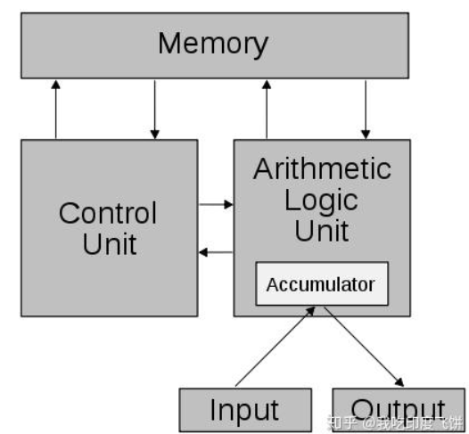
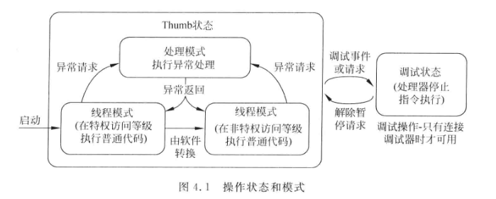

# ARM CortexM3&M4权威指南

## 计算机基础

#### 冯-诺依曼结构和哈佛结构

##### 冯诺伊曼结构

​	冯-诺依曼结构又被称为普林斯顿体系结构。该结构的处理器使用同一个存储器，经由同一个总线传输。冯诺依曼结构处理器有以下几个特点：

1. 必须有一个存储器
2. 必须有一个控制器
3. 必须有一个运算器，用于完成算术运算和逻辑运算
4. 必须有输入和输出设备，用于人机交互



##### 哈佛结构

​	哈佛结构将程序指令存储和数据存储分开的存储器结构。中央处理器首先到程序指令存储器中读取程序指令内容，解码后得到数据地址，再到相应的数据存储器中读取数据并进行下一步操作(通常为执行)。程序指令存储和数据存储分开，**可以使得指令和数据有不同的数据宽度**。

​	哈佛结构执行效率高，其程序指令和数据指令分开组织和存储，执行时可以预先读取下一条指令。哈佛的程序和数据空间相互独立，能够减轻程序运行时的访存瓶颈。

​	哈佛结构能基本解决取指和取数冲突的问题。

​	和冯-诺依曼结构结构相比，哈佛处理器有两个明显特点：

1. 使用两个独立的存储器模块，分别存储指令和数据，每个存储模块都不允许指令和数据并存
2. 使用两个独立的总线，分别作为CPU与每个存储器之间的专用通信路径。两条总线之间毫无关联

**改进型哈佛结构特点**：

	1. 使用两个独立的存储器模块，每个存储器模块都不允许指令和数据共存
	1. 具有一条独立的地址总线和一条独立的数据总线，利用**公用地址总线访问两个存储模块**(程序存储模块和数据存储模块)，**公共数据总线则被用来完成程序存储模块或数据存储模块与CPU之间的数据传输**
	1. 两条总线由程序存储器和数据存储器分时复用


## 1. 架构

### 1. 编程模型

#### 1. 操作模式和操作状态

针对ARM Cortex M3/M4处理器，处理器具有两个操作模式，两个状态以及两个访问等级。

1. 访问等级

   + 特权访问等级：可以访问处理器中的所有资源。
   + 非特权访问等级：某些存储区域不可以访问，也叫“用户”状态

2. 操作状态

   + 调试状态：处理器被暂停后,会进入调试状态，调试器停止运行。该状态仅用于调试操作，通过调试器发起调试请求或处理器中的调试不见产生的调试事件进入。该模式可以修改处理器寄存器数值。
   + Thumb状态：程序在执行程序代码时处于Thumb状态。

   操作状态用于区分处理器是正在正常执行代码还是在被调试器调试。

3. 操作模式

   + 处理模式：执行中断异常程序(ISR)等异常处理时处于处理模式。该模式总是处于特权访问等级。
   + 线程模式：执行普通程序代码。该模式可以处于特权访问等级也可处于非特权访问等级，具体由**CONTROL寄存器**控制。处理器可以从特权线程模式切换到非特权线程模式，但是不可以从非特权线程模式切换到特权线程模式，必须借助异常机制才可以。

   操作状态用于区分处理器是执行中断还是执行普通的程序代码。

Cortex M处理器在启动后默认处于特权线程模式，且使用MSP指针



#### 2. 寄存器

​	加载-存储架构：针对ARM架构，若处理的是存储器中的数据，则需要将其从存储器加载到寄存器组中的寄存器中。若处理器处理完后，若有必要还会写回寄存器中。

​	Cortex-M3和Cortex-M4处理器的寄存器组中有16个寄存器，13个为32位通用寄存器(R0-R12)，其他三个为R13栈指针(SP)寄存器,R14,链接寄存器(LR),以及R15程序寄存器(PC).

1. R0-R12通用寄存器

   ​	R0-R7被称为低寄存器。由于指令中可用的空间有限，许多16位指令只能访问低寄存器。高寄存器可用于32位指令和几个16位指令

2. R13 栈指针寄存器SP

   ​	通过PUSH和POP操作实现栈存储的访问。存在两个栈指针，MSP(主栈指针)和PSP(进程栈指针)

   MSP:复位后或处于处理模式时被使用

   PSP:只能用于线程模式

   ​	Cortex-M 的 MSP 和 PSP 是 32 位栈指针，架构要求 SP 至少保持 4 字节对齐，因此 SP[1:0] 恒为 0。PUSH/POP 每处理一个 32 位寄存器，SP 相应减少/增加 4 字节，因此正常的栈操作会保持这种 4 字节对齐。

   ​	PSP初始值未定义，MSP初始值需要在复位流程中从存储器的第一个字中取出。

3. R14 链接寄存器LR

   ​	用于**函数或子程序**调用时返回地址的保存。

   + 函数/子程序结束时，程序控制可将LR的值加载到PC中返回调用程序处并继续执行
   + 执行子程序/函数，LR数值会自动更新
   + 函数调用另外一个函数/子程序时，会将LR值保存在栈中。

   异常处理期间，LR值被更新为EXC_RETURN(异常返回)数值，之后该数值在异常结束后出发异常返回。

   Cortex-M返回地址总是偶数(Thumb指令架构决定)，其弟0位总是0。于是LR将第0位利用起来，该位可读可写，有些跳转/调用操作将LR第0位置1表示Thumb状态。

4. R15 程序计数器 PC

   可读可写，读操作返回当前指令地址加4(设计的流水线特性)，写操作引发跳转操作。

   ARM Cortex-M指令必须对齐到半字或字，PC的最低位(LSB)为0；在使用跳转/读存储器指令更新PC是常将PC的LSB置1，表示Thumb状态，否则会被判定为使用不支持的ARM状态而引发错误。


#### 3. 特殊寄存器

特殊寄存器表示处理器状态、定义了操作状态和中断/异常屏蔽。

特殊寄存器未经过存储器映射，使用MSR和MRS等特殊寄存器访问指令进行访问。

​											`MRS <reg>,<special_reg>`可以将MRS理解为 `MOVE reg special_reg `表示将特殊寄存器写入寄存器

​											`MSR <special_reg>,<reg>`可以将MSR理解为`MOVE special_reg  reg `表示写入特殊寄存器

1. **程序状态寄存器**

   程序状态寄存器包括三个寄存器：

   + APSR(应用PSR)
   + EPSR(执行PSR)
   + IPSR(中断PSR)

   三个寄存器通过一个组合寄存器访问，也被称为xPSR。ARM汇编器中访问xPSR使用PSR，也可以单独访问每个PSR

   ```
   MRS r0,PSR		;读取xPSR
   RSR PSR,r0		;写入xPSR
   ;单独访问
   MRS R0, APSR		;读取APSR
   MRS r0, IPSR		;读取异常/中断状态
   MSR APSR,r0			;写标志状态
   ```

   其中软件代码无法直接访问EPSR,且IPSR为只读的。

   

   

   

2. **PRIMASK,FAULTMASK和BASEPRI寄存器**

   用于屏蔽异常或中断，每个异常都有一个优先等级，等级越小优先级越高。只有在**特权优先级**可以访问这些寄存器，且默认为0；

   

   + PRIMASK

     阻止不可屏蔽中断(NMI)和HardFault异常之外的所有异常。实际上是将异常优先级提升为0，这也是可编程中断/异常的最高优先级

   + FAULTMASK

     阻止不可屏蔽中断(NMI)外的所有中断，包括HardFault.将优先等级提升为-1。和PRIMASK不同，FAULTMASK在异常返回时会被自动清除。

   + BASEPRI

     ARMv7-M架构支持BASEPRI。当前设置为非零值时，其会屏蔽具有相同或更低优先级的异常。

   

   `FAULTMASK和BASEPRO寄存器在ARMv6-M中不存在(如Cortex-M0)`

3. **CONTROL寄存器**

   定义了栈指针的选择和线程模式的访问等级。只能在特权访问等级进行修改。读取都可以

   

   + nPRIV：0线程模式处于特权等级  1线程模式处于非特权等级
   + SPSEL: 0线程模式使用MSP，1使用PSP.处理模式该位始终为0，且不可写。
   + FPCA：1当前上下文使用了浮点指令，需要保存浮点寄存器。在执行浮点指令自动置位，在异常入口会被清除。

   CONTROL寄存器的修改注意两点：

   1. 对于具有浮点单元的处理器，若程序包含浮点运算但FPCA位被意外清除，而且接下来产生一个中断，从而使得浮点寄存器不能再异常入口流程保存，且可能被中断处理覆盖，此时继续执行被中断任务时，程序可能无法继续正确处理。
   2. 修改完CONTROL寄存器后，应使用指令同步屏蔽指令(ISB)来确保本次修改对接下来的代码能起作用。

#### 4,浮点寄存器

1. S0-S31和D0-D15

   S0-S31为32位寄存器，且每个都可以通过浮点指令访问。或者通过D0-D15成对访问

   

   Cortex-M4浮点单元不支持双精度浮点运算，但在传输双精度数据时仍可使用浮点指令。

1. 浮点状态和控制寄存器(FPSCR)

​	


### 2. 应用程序状态寄存器

APSR有以下几组状态位：

+ 整数运算的状态标志(N-Z-C-V位)
+ 饱和运算的状态标志(Q位)
+ SIMD运算的状态标志(GE位)

#### 1. 整数状态标志

​	受普通数据处理指令的影响，在控制条件跳转和条件执行时非常有用。

+ N(负标志):设置为所执行指令得到结果的bit[31]位，为1时结果为正，为0时结果为负。
+ Z(零标志):执行指令结果为0或比较指令执行后两数相同，该位为1
+ C(进位标志):针对**无符号**加法，最高位产生进位置1。无符号减法，有借位置0. 如4-3则C=1,3-4则C=0;
+ V(溢出标志):**有符号**加或减，产生有符号溢出该位置1.正+正=负为正溢出。负+负=正为负溢出

计算机世界里，A-B=A+(-B)=A+(NOT B)+1.

针对多数32位指令，指令编码中的一个位定义了是否应该更新APSR标识。

部分指令不会更新V标志和C标志，如MULS(乘法)

APSR进位标志可将加法和减法运算扩大为超过32位。


#### 2.Q状态标志

​	饱和算术运算或饱和调整运算过程中产生了饱和。

#### 3.GE位

​	占用4位，仅在Cortex-M4中存在。用于SIMD指令。

### 3.存储器系统

#### 1. 存储器系统特性

+ 4GB线性地址空间。4GB=2^32.
+ 架构定义的存储器映射。4GB被划分为多个区域，用于预定义的存储器和外设。如Cortex M3/M4处理器具有多个总线接口，允许对程序代码用的CODE区域的访问和对SRAM或外设的数据操作同时进行。
+ 支持大端和小端的存储器系统。
+ 位段访问(可选)。包含位段特性时，存储器映射中的两个1MB区域可以通过两个位段区域进行寻址。可实现对单独位的原子操作
+ 写缓冲。
+ 存储器保护单元。
+ 非对齐传输。

CortexM处理器总线接口位通用总线接口，可通过不同的存储器控制器被连接到不同类型和大小的存储器。为控制系统中，程序代码用Flash(ROM)，数据用静态RAM(SRAM).

#### 2.存储器映射

被划分的多个存储区域主要用于

+ 程序代码访问
+ 数据访问
+ 外设
+ 处理器内部控制和调试部件。


#### 3.栈存储

栈:先进后出的存储结构。使用PUSH指令往栈中存储数据，使用POP指令往栈中提取数据。

作用：

+ 所执行的函数需要使用寄存器组的寄存器时，存储这些数据的值，处理完成后恢复。
+ 向函数或子程序中传递数据
+ 用于局部变量的存储
+ 在中断等异常产生时保存处理器状态和寄存器的值。

Cortex-M处理器使用的模型被称为“满递减”。处理器启动后SP处于栈存储空间的最后的位置。PUSH操作先减小SP值，随后将数据存储在SP指向的存储器位置。


PUSH/POP操作至少传输一个字的数据，且地址总是对齐到4字节边界上。SP最低位也总为0；

上电后处理器硬件在读取向量表后会自动初始化MSP的值。

#### 4. 存储器保护单元

多数嵌入式系统用不到存储器保护单元，在需要高可靠性的嵌入式系统中，MPU可以通过定义特权和非特权访问权限来保护存储器区域。

### 4.异常和中断

#### 1.什么是异常

​	异常是会改变工作流的事件，当其产生时，处理器会暂停当前正在执行的任务，转而执行一段称为异常处理的程序。对于ARM架构，中断就是异常的一种。中断可由外设或外部输入产生，有时也可由软件触发。

​	中断的异常处理也成为**中断处理程序(ISR)**

Cortex-M处理器有多个异常源：

+ NVIC处理异常：NVIC可以处理多个中断请求(IRQ)和一个不可屏蔽中断(NMI)请求,IRQ通过外设或外部输入I/O产生，NMI用于看门狗或掉电检测。内部SysTick定时器也会产生定时中断请求。

+ 处理器自身：处理器自身也会产生异常，包括系统错误状态的错误事件以及软件产生、支持嵌入式OS操作的异常。这些异常如下表

  | 异常编号 | CMSIS中断编号 | 异常类型      | 优先级   | 功能                                                         |
  | :------- | :------------ | :------------ | :------- | :----------------------------------------------------------- |
  | 1        | —             | 复位          | -3(最高) | 复位                                                         |
  | 2        | -14           | NMI           | -2       | 不可屏蔽中断                                                 |
  | 3        | -13           | 硬件错误      | -1       | 对于所有等级的错误，若相应的错误处理由于被禁止或被异常屏蔽阻止而未被激活，则会触发该异常 |
  | 4        | -12           | MemManage错误 | 可设置   | 存储器管理错误，由 MPU 冲突或非法访问引发（如从不可执行区域取指） |
  | 5        | -11           | 总线错误      | 可设置   | 从总线系统收到的错误响应，由指令预取终止和数据访问错误引发   |
  | 6        | -10           | 使用错误      | 可设置   | 使用错误，典型原因为非法指令或非法的状态转换尝试（如在 Cortex-M3 中试图切换至 ARM 状态） |
  | 7~10     | —             | —             | —        | 保留                                                         |
  | 11       | -5            | SVC           | 可设置   | 通过 SVC 实现的请求管理调用                                  |
  | 12       | -4            | 调试监控      | 可设置   | 调试监控，用于基于软件的调试（一般用不上）                   |
  | 13       | —             | —             | —        | 保留                                                         |
  | 14       | -2            | PendSV        | 可设置   | 可挂起的系统服务请求                                         |
  | 15       | -1            | SYSTICK       | 可设置   | 系统节拍定时器                                               |
  | 16~255   | 0~239         | IRQ           | 可设置   | IRQ 输入 #0~239                                              |

  每个异常源都有一个异常编号，1-15为系统异常，16以上被用为中断。

复位是一种特殊的异常，当处理器从复位退出时就会在线程模式下执行复位处理，IPSR中异常编号读出也是0.

#### 2. 嵌套向量中断控制器(NVIC)

NVIC为Cortex-M处理器的一部分，它是可编程的，且寄存器位于存储器映射的系统控制空间(CSC)，如图所示


NVIC作用：用于处理异常和中断配置、优先级以及中断屏蔽。

NVIC特性：

+ 灵活的异常和中断管理
  + 除了NMI的所有中断都可以被使能或禁止，而且都具有可由软件设置或清除的挂起状态。
+ 支持嵌套异常/中断
  + 每个异常都有优先级，异常产生时，若异常优先等级较高当前执行的任务就会被暂停，有些寄存器就会被保存在栈空间，且处理器会开始执行新的异常，这个过程就叫**“抢占”**。高优先级任务处理完成后会被异常返回操作终止，处理器自动从栈中恢复寄存器的内容，并继续执行之前的任务。这样异常嵌套不会带来任何软件开销。
+ 向量化的异常/中断入口
  + 异常发生时需要确定相应的异常处理入口的位置。Cortex-M处理器会从存储器的向量表中自动定位异常入口。
+ 中断屏蔽
  + Cortex-M3和Cortex-M4的NVIC提供了多个中断屏蔽寄存器。

NVIC可处理的中断源类型：

+ 脉冲中断请求:中断请求至少持续一个时钟周期，当NVIC在某个中断输入收到一个脉冲后，挂起状态就会置位且保持到中断得到处理。
+ 电平触发中断请求:在中断被处理前需要将中断源的请求保持为高。NVIC输入信号高电平有效。

#### 3. 向量表

​	异常产生且被处理器接受后相应的异常处理就会执行，要确认异常处理的起始地址，处理器利用了一种向量表的机制。

​	向量表为存储在系统存储器中，中的每个元素(异常向量)都表示一个异常类型的起始地址。向量表可以被重定向，由NVIC中的向量表偏移寄存器控制(VTOR).VTOR初始值为0.


​	每个异常向量最低位表示异常是否在Thumb状态下执行。Cortex-M处理器中该值为1.

#### 4. 错误处理

​	CortexM3/M4处理器中的几个异常为错误处理异常。检测到的错误包括执行未定义的指令以及总线错误对存储器访问返回错误的响应等。、

​	错误异常触发HartFault异常以便调试分析


### 5.系统控制块(SCB)

​	为处理器的一部分，位于NVIC中，用于：

1. 控制处理器配置(如低功耗模式)
2. 提供错误状态信息(错误状态寄存器)
3. 向量表重定位(VTOR)

### 6.调试

​	支持调试特性：

+ 在暂停和步进等执行控制
+ 指令断点
+ 数据监控点
+ 寄存器和存储器访问

支持接口：

+ 调试接口
  + 支持JATG和SWD
+ 跟踪接口
  + 串行线查看的单脚协议
  + 跟踪端口的多脚协议

### 7.复位和复位流程

复位类型：

+ 上电复位:复位微控制器的所有部分，包括处理器、调试部件和外设等
+ 系统复位：只会复位处理器和外设，不包括处理器的调试支持部件
+ 处理器复位：只复位处理器

复位流程：

​	复位后执行程序前，Cortex从存储器中读出头两个字，第一个为MSP的初始值，第二个为代表复位处理起始地址的复位向量，这两个值分别赋给MSP和PC寄存器。

​	MSP的设置非常有必要，因为在复位的很短时间内可能产生HardFault和NMI，在异常处理前将处理器状态压栈操作需要栈存储和MSP。

​	CortexM3和M4栈操作基于满递减的栈(SP在存储前减小),SP的初始值应被设置为栈区域顶部的第一个位置(即栈地址最大地方)。


## 2. 存储器系统

## 3.异常和中断


