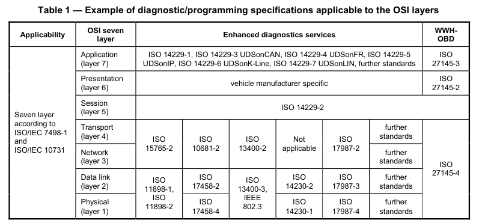

# ISO14229-1

# UDS(Unified diagnostic services统一诊断服务)

# Part-1规范与要求

## 1. 简介

ISO 14229 的制定是为了定义诊断系统的通用要求，无论采用何种串行数据链路。

ISO14229基于OSI七层模型为参考而制定，按照该模型进行映射时，诊断测试仪和ECU所使用的服务依据下表被划分到以下各层。

+ 应用层(第7层)：统一诊断服务规定于 ISO 14229-1、ISO 14229-3 UDSonCAN、ISO 14229-4 UDSonFR、ISO 14229-5 UDSonIP、ISO 14229-6 UDSonK-Line、ISO 14229-7 UDSonLIN、其他相关标准以及 ISO 27145-3 WWH-OBD。
+ 表示层(第6层):由车辆制造商规定，以及 ISO 27145-2 WWH-OBD。
+ 会话层服务(第5层):规定于ISO14229-2.
+ 传输层服务(第4层):规定于 ISO 15765-2 DoCAN、ISO 10681-2 FlexRay 通信、ISO 13400-2 DoIP、ISO 17987-2 LIN、ISO 27145-4 WWH-OBD。
+ 网络层服务(第3层):规定于 ISO 15765-2 DoCAN、ISO 10681-2 FlexRay 通信、ISO 13400-2 DoIP、ISO 17987-2 LIN、ISO 27145-4 WWH-OBD。
+ 数据链路层服务(第2层):规定于 ISO 11898-1、ISO 11898-2、ISO 17458-2、ISO 13400-3、IEEE 802.3、ISO 14230-2、ISO 17987-3 LIN 及其他相关标准、ISO 27145-4 WWH-OBD。
+ 物理层(第1层)：规定于 ISO 11898-1、ISO 11898-2、ISO 17458-4、ISO 13400-3、IEEE 802.3、ISO 14230-1、ISO 17987-4 LIN 及其他相关标准、ISO 27145-4 WWH-OBD。



## 2. Scope(范围)

​	ISO 14229 的本部分规定了诊断服务中与数据链路无关的要求，这些服务允许诊断测试仪（客户端）控制车载电子控制单元（ECU，服务器）中的诊断功能，例如连接至嵌入道路车辆中的串行数据链路的电子燃油喷射、自动变速箱、防抱死制动系统等。

​	它规定了通用服务，这些服务允许诊断测试仪（客户端）停止或恢复数据链路上的非诊断消息传输。

​	ISO 14229 的本部分不适用于两个电子控制单元（ECU）之间在车辆通信数据链路上的非诊断消息传输。然而，ISO 14229 的本部分不限制在 ECU 中实现车内车载测试仪（客户端），以便利用车辆通信数据链路上的诊断服务来执行双向诊断数据交换。

​	ISO 14229 的本部分不规定任何实现要求。

## 3.术语、定义、符号和缩略语

| 名称                        | 含义                                                         |
| --------------------------- | ------------------------------------------------------------ |
| boot software               | 在服务器的一个特殊部分中执行，主要用于启动并执行服务器编程的软件。 |
| client                      | 客户端：诊断仪的一部分，使用诊断服务的功能。测试仪(Tester)通常还会有其他功能,如数据库管理等。通常为诊断服务的发起者 |
| server                      | 接受请求，提供诊断服务并响应的一方                           |
| diagnostic data             | 存储于电子控制单元存储器中，并可由测试仪检查和/或可能修改的数据。 |
| diagnostic routine          | 嵌入在电子控制单元中、并且可由服务器在客户端请求时启动的例程。 |
| diagnostic service          | 由client发起的信息交换，目的是从server请求诊断信息，和/或为诊断目的修改server的行为 |
| diagnostic session          | 诊断会话：服务器内的一种状态，该状态下，特定的一组诊断服务和功能被启用 |
| diagnostic trouble code DTC | 车载诊断系统识别出的故障状况的数字通用标识符。               |
| ECU                         | 电子控制单元，包含至少一个服务                               |
| functional unit             | 一组功能相近或互补的诊断服务                                 |
| integer type                | 一种简单类型，其可区分的值为正整数和负整数，包括零。         |
| local client                | 连接到与服务端相同的本地网络，并且与服务端处于同一地址空间的客户端 |
| local server                | 连接到与客户端相同的本地网络，并且与客户端处于同一地址空间的服务端。 |
| OSI                         | 开放系统互连                                                 |
| permanent DTC               | 永久性诊断故障码:诊断故障码（DTC），即使在收到清除 DTC 请求之后，仍保留在非易失性存储器中，直到满足其他准则（通常是法规性准则）为止（例如，每个 DTC 的相应监视器已成功通过）。 |
| record                      | 一个或多个诊断数据元素，它们通过单一标识方式被一起引用。包含各种输入/输出数据和故障码的快照是记录的一个示例。 |
| remote server               | 远程服务器：不直接连接到主诊断网络的服务端                   |
| remote client               | 不直接连接到主诊断网络的客户端                               |
| reprogramming software      | 引导软件中允许对电子控制单元进行重新编程的部分。             |
| security                    | 用于保护车辆模块免遭通过车辆诊断数据链路进行的“未经授权”入侵的机制。 |
| server                      | 服务器：属于电子控制单元一部分、并提供诊断服务的功能。       |
| supported DTC               | 当前已配置/标定并使能，以在预定义车辆条件下执行的诊断故障码。 |
| tester                      | 测试仪：一种系统，它控制诸如对车载电子控制单元进行测试、检查、监测或诊断等功能，并且可能专用于某一特定类型的操作人员（例如，专供汽车修理厂技工使用的非车载扫描工具、专供装配厂使用的非车载测试工具，或车载测试仪）。 |
| .con                        | 服务原语(确认)                                               |
| .ind                        | 服务原语(指示)                                               |
| .req                        | 服务原语(请求)                                               |
| A_PCI                       | 应用层协议控制信息                                           |
| ECU                         | 电子控制单元                                                 |
| EDR                         | 事件数据记录器                                               |
| N/A                         | 不适用                                                       |
| NR_SI                       | 否定响应服务标识符                                           |
| NRC                         | 否定响应码                                                   |
| RA                          | 远程地址                                                     |
| SA                          | 源地址                                                       |
| SI                          | 服务标识符                                                   |
| TA                          | 目标地址                                                     |
| TA_Type                     | 目标地址类型                                                 |
| A_SDU                       | Application Service Data Unit应用层服务数据单元              |
| A_PDU                       | 在A_SDU外面进一步增加协议控制信息形成的数据单元。            |
| A_SA                        | 应用层源地址，表示谁发送的                                   |
| A_TA                        | 应用层目的地址，表示发给谁的                                 |

## 4. 惯例

​	本部分14229基于OSI服务约定中讨论的适用于诊断服务的各项约定。

​	这些约定规定了服务用户和服务提供者之间的交互。信息通过服务原语(service primitives)在服务用户和服务提供者之间传递。服务原语可携带参数。

​	服务与协议之间的区别如下图所示。


​	ISO的本部分定义了确认服务和非确认服务。

​	确认请求包括六种服务原语：request（请求）、req_confirm（请求确认）、indication（指示）、response（响应）、rsp_confirm（响应确认）和 confirmation（确认）。

​	非确认服务仅使用 request（请求）、req_confirm（请求确认）和 indication（指示）这三种服务原语。

​	对于 ISO 14229 本部分中定义的所有服务，请求（request）和指示（indication）服务原语始终具有相同的格式和参数。因此，对于所有服务而言，响应（response）和确认（confirmation）服务原语（req_confirm 和 rsp_confirm 除外）始终具有相同的格式和参数。在本国际标准中定义服务原语时，仅列出请求和响应服务原语。


## 5.文档概览


## 6.应用层服务

### 6.1概览

​	应用层通常称为诊断服务。应用层服务用于客户端-服务器的系统，用于执行车载服务器的测试、检查、监测或诊断等功能。客户端（通常称为外部测试设备）使用应用层服务，请求在一个或多个服务器中执行诊断功能。服务器（通常是 ECU 中的一项功能）使用应用层服务，将所请求诊断服务提供的响应数据发送回客户端。客户端通常是车外测试仪，但在某些系统中也可以是车载测试仪。应用层服务的使用与客户端是车外测试仪还是车载测试仪无关。同一车辆系统中可以有一个以上的客户端。

​	诊断应用层的服务访问点提供若干服务，这些服务都具有相同的总体结构。对于每项服务，均规定了六种服务原语：一种服务请求原语，由诊断测试仪应用中的客户端功能使用，用于将关于所请求诊断服务的数据传递给诊断应用层；

+ a service request primitive服务请求原语:由诊断测试仪应用中的客户端功能使用，用于将关于所请求诊断服务的数据传递给诊断应用层
+ a service request-confirmation primitive服务请求确认原语:由诊断测试仪应用中的客户端功能使用，用于指示在服务请求原语中传递的数据已成功发送到诊断测试仪所连接的车载通信总线上。
+ a service indication primitive服务通知原语:由诊断应用层使用，用于将数据传递给ECU诊断应用或服务器的功能
+ a service response primitive服务回复原语:由 ECU 诊断应用中的服务器功能使用，用于将**所请求诊断服务**提供的**响应数据**传递给诊断应用层；
+ a service response-confirmation primitive服务回复确认原语:由 ECU 诊断应用中的服务器功能使用，用于指示在服务响应原语中传递的数据已成功发送到 ECU 接收诊断请求的车载通信总线上；
+ a service confirmation primitive服务确认原语:由诊断应用层使用，用于将数据传递给诊断测试仪应用中的客户端功能。

下图展示了应用层服务原语-确认服务


下图展示了应用层服务原语-非确认服务


​	对于给定服务，请求确认原语和响应确认原语始终具有相同的服务数据单元。这些服务原语的目的是指示较早的请求或响应服务原语调用的完成。本国际标准中的服务描述不会使用这些服务原语，但数据链路特定的实现文档可能会使用它们来定义例如服务执行参考点（例如，当响应完全传输到客户端时，ECUReset 服务将调用复位，这一点通过服务响应确认原语在服务器中指示）。

### 6.2 应用层服务的格式描述

​	应用层服务可以有两种不同的格式，具体取决于车辆诊断系统的配置方式。应用层服务的格式由参数 **A_Mtype** 控制。

​	如果车辆系统的配置使得客户端可以通过使用 **A_SA** 和 **A_TA** 地址参数来寻址所有服务器，则应使用应用层服务的**默认格式**。这意味着 **A_Mtype = diagnostics**。

​	如果车辆系统的配置使得客户端除了 **A_SA** 和 **A_TA** 地址参数之外还需要地址信息，以便能够寻址某些服务器，则应使用应用层服务的**远程格式**。这意味着 **A_Mtype = remote diagnostics**。

应用层服务的不同格式在 **6.3** 中规定。

### 6.3 服务原语的格式描述

明确了应用程序和应用层之间如何交互

#### 6.3.1 一般定义

​	所有应用层服务都具有相同的总体格式。服务原语按以下形式书写：

​			`service_name.type (
​			parameter A, parameter B, parameter C
​			[,parameter 1, ...] )`

+ service_name:诊断服务的名称
+ type:服务原语的类型(如request)
+ "parameter A,......":该参数是 A_SDU（应用层服务数据单元），即由服务原语传递的值列表（寻址信息）
+ "parameter A,parameter B,parameter C"是强制参数，应包含在所有服务调用中；
+ "[,parameter 1,...]"是取决于具体服务的参数（例如，parameter 1 可以是 DiagnosticSessionControl 服务的 diagnosticSession）。方括号表示参数列表的这一部分可以为空。

#### 6.3.2 服务请求和服务指示原语(request和indication)

请求原语由诊断测试仪应用中的客户端功能使用，用于发起服务，并将关于所请求诊断服务的数据(应用程序层)传递到应用层。


指示原语由应用层使用，用于指示一个对 ECU 诊断应用有重要意义的内部事件，并将关于所请求诊断服务的数据传递给 ECU 诊断应用的服务器功能(应用层传给应用程序)。


​	特定应用层服务的请求原语（request primitive）和指示原语（indication primitive）始终具有相同的参数及参数值。这意味着，当数据从客户端传输到服务器端时，应用层中相互通信的对等协议实体不得更改各个参数的取值。在客户端应用程序调用服务请求时，客户端函数传递给应用层的参数值，必须与服务器端诊断应用程序中的服务器函数通过对等应用层的服务指示所接收到的参数值完全相同。

#### 6.3.3 服务响应和服务确认原语(response和confirm)

​	响应原语由 ECU 诊断应用中的服务器功能使用，用于发起服务，并将所请求诊断服务提供的响应数据(应用程序层)传递给应用层。


​	确认原语（confirm primitive）由应用层使用，用于向诊断测试仪应用程序中的客户端函数指示一个对客户端应用程序具有重要意义的内部事件，并传递与先前某个服务请求相关的结果。它并不一定表示远端对等接口发生了任何活动，例如：当服务器不支持所请求的服务，或者通信中断时。


​	特定应用层服务的响应原语（response primitive）和确认原语（confirm primitive）始终具有相同的参数及参数值。这意味着，当数据从服务器传输到客户端时，应用层中相互通信的对等协议实体不得更改各个参数的取值。在 ECU 诊断应用程序中，服务器函数调用服务响应时传递给应用层的参数值，必须与诊断测试仪应用程序中的客户端函数通过对等应用层的服务确认所接收到的参数值完全相同。

对于每一种响应原语和确认原语，都将定义两种不同的服务数据单元（即两组参数）。

- 如果 ECU 中的服务器函数能够成功执行所请求的诊断服务，则应使用第一种服务数据单元，即肯定响应（positive response）和肯定确认（positive confirm）原语。
- 如果 ECU 中的服务器函数执行所请求的诊断服务失败，或者未能在规定时间内完成该服务，则应使用第二种服务数据单元，即否定响应（negative response）和否定确认（negative confirm）原语。


#### 6.3.4 服务请求确认和服务响应确认原语(request-confirm和response-confirm)

​	请求确认原语（request-confirm primitive）由应用层使用，用于向客户端应用程序指示一个对其具有重要意义的内部事件，并将与先前某个服务请求相关的**通信结果**传递给诊断测试仪应用程序中的客户端函数。


​	响应确认原语（response-confirm primitive）由应用层使用，用于向服务器应用程序指示一个对其具有重要意义的内部事件，并将与先前某个服务响应相关的通信结果传递给 ECU 应用程序中的服务器函数。


### 6.4 服务数据单元规范(A_SDU)

#### 6.4.1 强制参数(Mandatory parameters)

##### 6.4.1.1 一般定义

​	应用层服务包含三个必备参数。以下参数定义适用于本国际标准中规定的所有应用层服务（包括标准格式和远程格式）。

##### 6.4.1.2 A_Mtype,应用层消息类型

+ 类型：枚举类型

+ 范围：诊断，远程诊断

+ 描述：参数 **Mtype** 应用于标识 **6.2** 中规定的车辆诊断系统的格式。ISO 14229 的本部分为该参数规定了两个取值：如果 **A_Mtype = diagnostics**，则 **service_name** 原语应由参数 **A_SA**、**A_TA** 和 **A_TAtype** 组成。

  如果 **A_Mtype = remote diagnostics**，则 **service_name** 原语应由参数 **A_SA**、**A_TA**、**A_TAtype** 和 **A_AE** 组成。

##### 6.4.1.3 A_SA,应用层源地址

+ 类型:两字节无符号整数值

+ 范围:0x0000-0xFFFF

+ 描述:参数 **SA** 应用于编码客户端和服务器标识符。

  ​	对于服务请求（以及服务指示），**A_SA** 表示已请求该诊断服务的**客户端功能**的地址。每个请求诊断服务的客户端功能都应使用一个 **A_SA** 值来表示。如果在同一诊断测试仪中实现了多个客户端功能，则每个客户端功能都应具有自己的**客户端标识符**以及相应的 **A_SA** 值。

  ​	对于服务响应（以及服务确认），**A_SA** 表示已执行**所请求诊断服务的服务器功能**的地址。服务器功能可以仅在一个 **ECU** 中实现，也可以分布实现在多个 **ECU** 中。如果服务器功能仅在一个 ECU 中实现，则它应仅用一个 **A_SA** 值来编码。如果服务器功能分布实现在多个 ECU 中，则各个服务器功能地址应针对每个单独的服务器功能各用一个 **A_SA** 值来编码。

  ​	如果远程Client或Server是某条消息的原始源，那么 `A_SA` 表示本地服务器，即承担远程网络与主网络之间网关功能的服务器。

+ 注意: 若请求消息采用物理寻址，则响应消息中的 A_SA 值将与相应请求消息中的 A_TA 值一致。

**如何理解**：A_SA的值不是固定的，针对服务请求(request),其表示已经请求该服务的Client的地址。针对服务响应(response),其表示执行所请求服务的Server的地址。

##### 6.4.1.4 A_TA,应用层目的地址

+ 类型:两字节无符号整数值

+ 范围:0x0000-0xFFFF

+ 描述:参数 **A_TA** 应用于编码客户端和服务器标识符。

  ​	在诊断中规定了两种不同的寻址方法:**物理寻址 和 功能寻址**。因此一个车辆系统可以定义两套独立的目标地址，分别用于每种寻址方法。

  ​	**物理地址**应始终是发送给在单个 ECU 中实现的服务器的专用消息。当使用物理寻址时，通信是客户端与服务器之间的点对点通信。

  ​	**功能地址**如果客户端不知道应对诊断服务请求作出响应的服务器功能的物理地址，或者该服务器功能是作为分布式功能在多个 ECU 中实现的，则客户端使用功能寻址。当使用功能寻址时，通信是从客户端到在一个或多个 ECU 中实现的服务器的广播通信。

  ​	对于服务请求（以及服务指示），**A_TA** 表示应执行所请求诊断服务的服务器的服务器标识符。如果正在寻址的是远程服务器，则 **A_TA** 表示作为从主网络到远程网络之网关的本地服务器。

  ​	对于服务响应（以及服务确认），**A_TA** 表示最初请求该诊断服务、并应接收所请求数据的**客户端功能**的地址（即请求中的 **A_SA**）。服务响应（以及服务确认）应始终使用**物理寻址**。如果正在寻址的是远程客户端，则 **A_TA** 表示作为从主网络到远程网络之网关的本地服务器。
  
+ 注意:响应消息中的 A_TA 值将与相应请求消息中的 A_SA 值一致。

##### 6.4.1.5 A_TA_Type,应用层目的地址类型

+ 类型:枚举

+ 范围:physical,functional

+ 描述:参数 **A_TA_type** 是 **A_TA** 参数的扩展。它用于表示消息传输所选择的寻址方法。

##### 6.4.1.6 A_Result

+ 类型:枚举

+ 范围:ok,error

+ 描述:参数 **A_Result** 由 **req_confirm** 和 **rsp_confirm** 原语使用，用于指示消息是否已正确传输（**ok**），或者消息传输是否未成功（**error**）。

##### 6.4.1.7 A_Length

+ 类型:四字节无符号整数

+ 范围:0d – (2^32-1)d

+ 描述:该参数包含要发送/接收的数据长度。

##### 6.4.1.8 A_Data

+ 类型:字节串

+ 范围:无

+ 描述:该参数包含由更高层实体交换的所有数据。

#### 6.4.2 车辆系统需求

​	车辆制造商应确保系统中的每个server都具有唯一的服务器标识符。车辆制造商还应确保系统中的每个client都具有唯一的客户端标识符。

​	车辆系统中诊断网络的所有客户端地址和服务器地址应编码到相同的源地址范围内。这意味着，在给定的车辆系统中，客户端和服务器不得由相同的 **A_SA** 值来表示。

​	server的物理目标(Physical Address,用于寻址server的地址)地址(A_TA)应始终与该服务器的源地址(Server的A_SA)相同。

​	远程服务器标识符可以独立于主网络上的客户端标识符和服务器标识符进行分配。

​	通常，只有被寻址的服务器应响应客户端请求消息。

#### 6.4.3 可选参数-A_AE,应用层远程地址

+ 类型:2字节无符号整数

+ 范围:0x0000 – 0xFFFF

+ 描述:**A_AE** 用于扩展可用的地址范围，以编码客户端和服务器标识符。**A_AE** 应仅用于实现了**本地服务器**和**远程服务器**概念的车辆中。远程地址表示其自身的地址范围，并且独立于主网络上的地址。

  ​	参数 **A_AE** 应用于编码远程客户端和服务器标识符。根据携带 **A_AE** 的消息的传输方向，**A_AE** 既可以表示远程目标地址，也可以表示远程源地址。

  ​	对于由主网络上的客户端发送的服务请求（以及服务指示），**A_AE** 表示应执行所请求诊断服务的服务器的**远程服务器标识符**（**远程目标地址**）

  ​	**A_AE** 既可以用作**物理地址**，也可以用作**功能地址**。对于 **A_AE** 的每个取值，**系统构建者**应规定该值表示的是**物理地址**还是**功能地址**。

  ​	注意：没有一种特殊参数，能够像 **A_TA_type** 为 **A_TA** 指定寻址方法那样，来表示物理远程地址或功能远程地址。物理远程地址和功能远程地址共享同一个 **1 字节**取值范围，每个取值的含义应由**系统构建者**定义。

  ​	对于由远程服务器发送的服务响应（以及服务确认），**A_AE** 表示已执行所请求诊断服务的远程服务器的**物理位置**（**远程源地址**）

  ​	远程服务器可以仅在一个 ECU 中实现，也可以分布实现在多个 ECU 中。如果远程服务器仅在一个 ECU 中实现，则它应仅用一个 **A_AE** 值来编码。如果远程服务器分布实现在多个 ECU 中，则远程服务器标识符应针对该远程服务器的每个物理位置各用一个 **A_AE** 值来编码。

## 7. 应用层协议

### 7.1 一般定义

​	应用层协议应始终采用**确认式消息传输**，这意味着对于客户端发送的每个服务请求，服务器应发送一个或多个对应的响应。

​	该规则的唯一例外应是少数几种情况：使用功能寻址，或者请求/指示规定不得生成响应/确认。为了避免系统因大量不必要的消息而负担过重，在少数情况下，即使服务器未能完成所请求的诊断服务，也不应发送否定响应消息。这些例外情况在本规范的相关系目中描述（例如，参见 7.5）。

​	应用层协议应与会话层协议并行处理。这意味着，即使客户端正在等待对先前请求的响应，它也应维持适当的会话层定时（例如，如果需要保持其他服务器中的诊断会话继续进行，则发送 TesterPresent 请求。具体实现取决于所使用的数据链路层）。

### 7.2 协议数据单元规范

**A_PDU**（应用层协议数据单元）直接由 **A_SDU**（应用层服务数据单元）和层特定控制信息 **A_PCI**（应用层协议控制信息）构成。**A_PDU** 应具有以下总体格式：


+ "Mtype,SA,TA,TA_Type,RA,Length"是与A_SDU中所用的参数相同的参数。其中RA表示远程地址
+ “A_Data"是为每个具体应用层服务定义的字节串。A_Data 串应以 A_PCI 开始，随后是该服务规定的来自 A_SDU 的所有服务特定参数。方括号表示参数列表中的该部分可以为空；
+ "Length"决定 A_Data 的字节数；

### 7.3 应用层协议控制信息(A_PCI)

#### 7.3.1 PCI，协议控制信息

​	A_PCI 由两种格式组成。这些格式由 A_PCI 参数第一个字节的值来标识。对于所有服务请求，以及第一个字节不等于 **0x7F** 的服务响应，应适用以下定义：

​							`A_PCI(SI)`

+ SI是参数**服务标识符**；

​	对于第一个字节等于 **0x7F** 的服务响应，应适用以下定义：

​							`A_PCI(NR_SI,SI)`

+ NR_SI是用于标识否定服务响应/确认的特殊参数；
+ SI是参数**服务标识符**；

提示：对于服务 **ReadDataByPeriodicIdentifier**（0x2A，参见 10.5）中定义的周期性数据响应消息的传输，应用层协议数据单元（**A_PDU**）中不存在 **A_PCI**。

#### 7.3.2 SI，服务标识

+ 类型:1字节无符号整数
+ 范围:0x00 – 0xFF，根据下表中的定义。


提示：请求消息的服务标识符与肯定响应消息的服务标识符之间存在一一对应关系，其中 **SI 字节值的 bit 6** 表示服务类型。所有请求消息的 **SI bit 6 = 0**。所有肯定响应消息的 **SI bit 6 = 1**，但 **ReadDataByPeriodicIdentifier**（0x2A，参见 10.5）服务的周期性数据响应消息除外。

+ 描述：**SI** 应用于编码服务原语中所调用的具体服务。每个请求服务应分配一个唯一的 **SI** 值。每个肯定响应服务应分配一个对应的唯一 **SI** 值。

  ​	服务标识符用于在 **A_Data** 数据串中表示服务，该数据串从应用层传递到下层（并从下层返回）。

#### 7.3.3 NR_SI,负响应服务标识符

+ 类型:一字节无符号整数
+ 唯一值:0x7F
+ 描述:参数 **NR_SI** 是用于标识否定服务响应/确认的特殊参数。对于否定响应/确认消息，它应作为 **A_PCI** 的一部分。

提示：**NR_SI** 值与 **SI** 值相协调。为了便于 **A_Data** 的编码和解码，**NR_SI** 值不被用作 **SI** 值。（`NR_SI` 被专门分配了一个固定值 `0x7F`，并且这个值不作为普通的服务标识符 `SI` 使用，这样接收方就可以更容易地区分否定响应和其他诊断报文）

### 7.4 否定响应/确认服务原语

​	每个诊断服务都有一个否定响应/否定确认消息，其消息 **A_Data** 字节按**表 3** 规定。第一个 **A_Data** 字节（A_PCI.NRC）始终是特定的**否定响应服务标识符**。第二个 **A_Data** 字节（A_PCI.SI）应是该否定响应消息所对应的**服务请求/指示消息**中的**服务标识符值**的副本。


提示：A_Data 表示否定响应消息的消息数据字节。

参数 **responseCode** 用于否定响应消息中，以指示诊断服务失败或未能及时完成的原因。其取值定义在 **A.1** 中。

### 7.5 服务响应实现规则

#### 7.5.1 一般定义

​	以下子条款规定了服务器在执行服务时的行为。服务器和客户端应遵循这些实现规则。

| 缩写                           | 描述                                                         |
| ------------------------------ | ------------------------------------------------------------ |
| suppressPosRspMsgIndicationBit | 积极响应抑制位。TRUE = 服务器不得发送肯定响应消息（例外情况参见附录 A.1 中 NRC 0x78 的定义）                                                        FALSE = 服务器应发送肯定或否定响应消息 |
| PosRsp                         | 正响应                                                       |
| NegRsp                         | 负响应                                                       |
| NoRsp                          | 不发送肯定响应消息或否定响应消息的缩写                       |
| NRC                            | 负响应码的缩写                                               |
| ALL                            | 客户端请求消息中所有被请求的数据参数均由服务器支持。         |
| At least 1                     | 客户端请求消息中至少有 **1** 个数据参数必须由服务器支持。    |
| None                           | 客户端请求消息中所请求的数据参数均不受服务器支持。           |

无论采用哪种寻址模式（物理寻址或功能寻址类型），服务器都应支持其诊断服务列表。

**重要**——如下述子条款中的表格所要求，当请求消息使用了**功能寻址**时，不得发送带有以下**否定响应码**的**否定响应消息**：**SNS**（服务不支持）、**SNSIAS**（活动会话中服务不支持）、**SFNS**（子功能不支持）、**SFNSIAS**（活动会话中子功能不支持）和 **ROOR**（请求超出范围）（例外情况参见 **NRC 0x78** 定义中的**附录 A.1**）。

#### 7.5.2 服务器响应一般行为

本小节规定的服务器通用响应行为适用于所有请求消息，且必须遵守。验证步骤从接收到请求消息时开始。该图分为三个小节。

+ mandatory(强制的):需针对每条请求消息进行评估；
+ optional:每条请求消息可选择性地进行评估；
+ manufacturer/supplier specific:该程序可通过额外的制造商/供应商特定检查进行扩展

提示:根据所有说明 NRC 处理的图表中所做的不同选择，无法保证对所有可能的测试模式序列都得到某一特定的 NRC。

下图描述了服务器响应的一般行为


关键点：

1. 诊断请求无法被接受，因为另一个诊断任务已由不同的客户端请求且正在进行中。
2. 参见每项服务的响应行为（支持的否定响应码）。

#### 7.5.3 包含子功能参数的请求消息及服务器响应行为

##### 7.5.3.1 带子功能参数的请求消息的通用服务器响应行为

​	本子条款中规定的通用服务器响应行为，对所有带子功能参数的请求消息均为必须遵守的要求。在本节语境中，请求消息被定义为符合 ISO 14229 本部分所规定格式要求的服务请求消息。

​	下图描述了带子功能参数的请求消息的一般服务器响应行为。


KEY:

1. 至少长度为2(SID+SubFunction Parameter)
2. 如果子功能需要进行序列检查，例如 LinkControl 或 SecurityAccess。
3. 参见每项服务的响应行为（所支持的否定响应码）。

##### 7.5.3.2 采用物理寻址的客户端请求消息

​	本子条款中规定的服务器响应行为，在每项服务的服务描述中均被引用；这些服务在从客户端接收的**物理寻址请求消息**中支持**子功能参数**。

​	下表展示了采用物理寻址的可能通信方案。

						**带子功能参数的物理寻址请求消息与服务器响应行为**

a) .服务器发送肯定响应消息，因为客户端请求中的服务标识符和子功能参数受到支持，并且该请求指示需要响应消息。

b) .服务器发送否定响应消息（例如，**IMLOIF**：消息长度不正确或格式不正确），因为客户端请求中的服务标识符和子功能参数是受支持的，但在处理该子功能期间出现了其他错误（例如，根据请求消息中的服务标识符和子功能参数判断，**PDU 长度**错误）。

c) .服务器发送一条否定响应消息，其否定响应码为 **ROOR**（**requestOutOfRange**，请求超出范围），因为服务标识符和子功能参数受支持，但客户端请求消息中所请求的数据参数均不受支持。

d) .服务器发送否定响应消息，否定响应码为 SNS（serviceNotSupported，服务不支持）或 SNSIAS（serviceNotSupportedInActiveSession，活动会话中服务不支持），原因是客户端请求中指示需要响应消息的服务标识符不受支持。

e) .服务器发送一条否定响应消息，其否定响应码为 **SFNS**（**sub-functionNotSupported**，子功能不支持）或 **SFNSIAS**（**sub-FunctionNotSupportedInActiveSession**，活动会话中子功能不支持），因为服务标识符受支持，但对于带有响应消息指示的客户端请求中的数据参数（如果适用），其子功能参数不受支持。

f) .服务器不发送响应消息，因为客户端请求中的**服务标识符**和**子功能参数**受支持，且该请求带有“不发送响应消息”的指示。

注：如果使用了否定响应码 **RCRRP**（**requestCorrectlyReceivedResponsePending**，请求已正确接收，响应挂起），则无论 **suppressPosRspMsgIndicationBit** 的值如何，都应给出最终响应。

g) .与 b) 中的效果相同（即，会发送一条否定响应消息），因为对于物理寻址请求消息上任何需要发送的否定响应，**suppressPosRspMsgIndicationBit** 都会被忽略。

h) .与 c) 中的效果相同（即，会发送一条否定响应消息），因为对于物理寻址请求消息上任何需要发送的否定响应，**suppressPosRspMsgIndicationBit** 都会被忽略。

i) .与 d) 中的效果相同（即，会发送一条否定响应消息），因为对于物理寻址请求消息上任何需要发送的否定响应，**suppressPosRspMsgIndicationBit** 都会被忽略。

j) .与 e) 中的效果相同（即，会发送一条否定响应消息），因为对于物理寻址请求消息上任何需要发送的否定响应，**suppressPosRspMsgIndicationBit** 都会被忽略。

##### 7.5.3.3 功能寻址的客户端请求消息

​	本子条款中规定的服务器响应行为，在每项服务的服务描述中均被引用；这些服务在从客户端接收的**功能寻址请求消息**中支持**子功能参数**。

下表展示了采用物理寻址的可能通信方案。

						**带子功能参数的功能寻址请求消息与服务器响应行为**

针对带子功能的功能寻址客户端请求消息，服务器响应情况说明：

a) .服务器发送肯定响应消息，因为客户端请求中的服务标识符和子功能参数受支持，且该请求带有需要响应消息的指示。

b) .服务器发送一条否定响应消息（例如，**IMLOIF**：**incorrectMessageLengthOrIncorrectFormat**，消息长度不正确或格式不正确），因为客户端请求中的**服务标识符**和**子功能参数**受支持，但在处理该子功能期间出现了其他错误（例如，根据请求消息中的服务标识符和子功能参数判断，**PDU 长度**错误）。

c) .服务器不发送响应消息，因为对于功能寻址的请求消息，否定响应码 ROOR（requestOutOfRange，请求超出范围）始终会被抑制。服务器之所以识别出该 NRC，是因为服务标识符和子功能参数虽然受支持，但客户端请求中所需的某个数据参数不受支持。在这种情况下，suppressPosRspMsgIndicationBit 无关紧要。

d) .服务器不发送响应消息，因为对于功能寻址的请求消息，否定响应码 **SNS**（**serviceNotSupported**，服务不支持）和 **SNSIAS**（**serviceNotSupportedInActiveSession**，活动会话中服务不支持）总是被抑制。这些否定响应码由服务器识别，原因是客户端请求中的服务标识符不受支持。在这种情况下，**suppressPosRspMsgIndicationBit** 不起作用。

e) .服务器不发送响应消息，因为对于**功能寻址请求**，否定响应码 **SFNS**（**sub-functionNotSupported**，子功能不支持）和 **SFNSIAS**（**sub-functionNotSupportedInActiveSession**，活动会话中子功能不支持）总是被抑制。这些否定响应码由服务器识别，原因是：**服务标识符**受支持，但对于客户端请求中的**数据参数**（如果适用），其**子功能参数**不受支持。在这种情况下，**suppressPosRspMsgIndicationBit** 不起作用。

f) .服务器不发送响应消息，因为客户端请求中的**服务标识符**和**子功能参数**受支持，且该请求带有“不发送响应消息”的指示。

**注：**如果使用了否定响应码 **RCRRP**（**requestCorrectlyReceivedResponsePending**，请求已正确接收，响应挂起），则无论 **suppressPosRspMsgIndicationBit** 的值如何，都应给出最终响应。

g) .与 b) 中的效果相同（即，会发送否定响应消息），因为对于任何否定响应，**suppressPosRspMsgIndicationBit** 都会被忽略。即使请求消息采用功能寻址，这一点也同样成立。

h) .与 c) 中的效果相同（即，不发送响应消息），因为对于**功能寻址请求消息**，否定响应码 **ROOR**（**requestOutOfRange**，请求超出范围）总是被抑制。该 ROOR 由服务器识别，原因是：**服务标识符**和**子功能参数**受支持，但客户端请求中所需的某个**数据参数**不受支持。在这种情况下，**suppressPosRspMsgIndicationBit** 不起作用。

i) .与 d) 中的效果相同（即，不发送响应消息），因为对于**功能寻址请求消息**，否定响应码 **SNS**（**serviceNotSupported**，服务不支持）和 **SNSIAS**（**serviceNotSupportedInActiveSession**，活动会话中服务不支持）总是被抑制。这些否定响应码由服务器识别，原因是客户端请求中的**服务标识符**不受支持。在这种情况下，**suppressPosRspMsgIndicationBit** 不起作用。

j) .与 e) 中的效果相同（即，不发送响应消息），因为对于**功能寻址请求消息**，否定响应码 **SFNS**（**sub-functionNotSupported**，子功能不支持）和 **SFNSIAS**（**sub-functionNotSupportedInActiveSession**，活动会话中子功能不支持）总是被抑制。这些否定响应码由服务器识别，原因是：**服务标识符**受支持，但客户端请求中的**子功能参数**不受支持。在这种情况下，**suppressPosRspMsgIndicationBit** 不起作用。

#### 7.5.4 不含子功能参数的请求消息及服务器响应行为

##### 7.5.4.1 无子功能参数请求消息的一般服务器响应行为

​	对于不带子功能参数的请求消息，没有可用的通用服务器响应行为。在本节语境中，请求消息定义为符合 ISO 14229 本部分所规定格式要求的服务请求消息。

##### 7.5.4.2 物理寻址的客户端请求消息

​	本子条款中规定的服务器响应行为，在每项服务的服务描述中均被引用；这些服务不支持子功能参数，但支持从客户端接收的**物理寻址请求消息**中的**数据参数**。

​	下表展示了物理寻址方式下可能的通信方案


​						**不带子功能参数的物理寻址请求消息与服务器响应行为**

a)服务器发送肯定响应消息，因为客户端请求消息中的**服务标识符**和**所有数据参数**均受支持。

b)服务器发送肯定响应消息，因为客户端请求消息中的**服务标识符**和**至少一个数据参数**受支持。

c)服务器发送一条否定响应消息（例如，**IMLOIF**：**incorrectMessageLengthOrIncorrectFormat**，消息长度不正确或格式不正确），因为**服务标识符**受支持，且客户端请求消息中**至少有一个数据参数**受支持，但在处理该服务期间发生了其他错误（例如，请求消息长度错误）。

d)服务器发送一条否定响应消息，其否定响应码为 **ROOR**（**requestOutOfRange**，请求超出范围），因为**服务标识符**受支持，而客户端请求消息中所请求的**数据参数**均不受支持。

e)服务器发送一条否定响应消息，其否定响应码为 **SNS**（**serviceNotSupported**，服务不支持）或 **SNSIAS**（**serviceNotSupportedInActiveSession**，活动会话中服务不支持），因为客户端请求消息中的**服务标识符**不受支持。

##### 7.5.4.3 功能寻址的客户端请求消息

​	本子条款中规定的服务器响应行为，在每项服务的服务描述中均被引用；这些服务不支持子功能参数，但支持从客户端接收的**功能寻址请求消息**中的**数据参数**

下表展示了功能寻址方式下可能的通信方案

						**不带子功能参数的功能寻址请求消息与服务器响应行为**

a)服务器发送肯定响应消息，因为客户端请求消息中的**服务标识符**和**所有数据参数**均受支持。

b)服务器发送肯定响应消息，因为客户端请求消息中的**服务标识符**和**至少一个数据参数**受支持。

c)服务器发送一条否定响应消息（例如 **IMLOIF**：**incorrectMessageLengthOrIncorrectFormat**，消息长度不正确或格式不正确），因为**服务标识符**受支持，并且客户端请求消息中的**至少一个、多个或所有数据参数**都受支持，但在处理该服务期间发生了其他错误（例如，请求消息长度错误）。

d)服务器不发送响应消息，因为对于**功能寻址请求**，否定响应码 **ROOR**（**requestOutOfRange**，请求超出范围）总是被抑制。该否定响应码会出现，原因是：**服务标识符**受支持，但客户端请求中所请求的**数据参数**均不受支持。

e)服务器不发送响应消息，因为对于**功能寻址请求**，否定响应码 **SNS**（**serviceNotSupported**，服务不支持）和 **SNSIAS**（**serviceNotSupportedInActiveSession**，活动会话中服务不支持）总是被抑制。这些否定响应码由服务器识别，原因是客户端请求中的**服务标识符**不受支持。

#### 7.5.5 服务器响应行为的伪代码示例

```
SWITCH (A_PDU.A_Data.A_PCI.SI)
{
    // ==========================================
    // 场景 1：包含子功能（Sub-function）的服务
    // ==========================================
    CASE Service_with_sub-function:
        // 检查包含子功能的消息最小长度（SID + Sub-function = 2字节）
        IF (message_length >= 2) THEN
            // 提取子功能参数值（屏蔽 bit 7，获取实际子功能编号）
            SWITCH (A_PDU.A_Data.A_Data.Parameter1 & 0x7F)
            {
                // 测试并准备具体子功能的响应
                CASE sub-function_00:
                    IF (message_length == expected_sub-function_message_length) THEN
                        // [TODO: 执行具体业务逻辑]
                        responseCode = positiveResponse; // 肯定响应，内部 NRC = 0x00
                    ELSE
                        responseCode = IMLOIF;           // NRC 0x13: 消息长度错误或格式无效
                    ENDIF
                    BREAK;

                CASE sub-function_01:
                    // [TODO: 执行具体业务逻辑]
                    responseCode = positiveResponse;     // 肯定响应，内部 NRC = 0x00
                    BREAK;

                // ... (省略中间的子功能) ...

                CASE sub-function_127:
                    // [TODO: 执行具体业务逻辑]
                    responseCode = positiveResponse;     // 肯定响应，内部 NRC = 0x00
                    BREAK;

                DEFAULT:
                    responseCode = SFNS;                 // NRC 0x12: 不支持该子功能
            }
        ELSE
            responseCode = IMLOIF;                       // NRC 0x13: 消息长度错误或格式无效
        ENDIF

        // 提取最高位（bit 7）作为“抑制肯定响应消息指示位”
        suppressPosRspMsgIndicationBit = (A_PDU.A_Data.Parameter1 & 0x80); // 结果为 0x00 或 0x80

        // 判断是否需要抑制肯定响应
        IF ( (suppressPosRspMsgIndicationBit) && 
             (responseCode == positiveResponse) && 
             ("not yet a NRC 0x78 response sent") ) THEN
            suppressResponse = TRUE;   // 设置标志：不发送肯定响应
        ELSE
            suppressResponse = FALSE;  // 设置标志：发送响应
        ENDIF
        BREAK;

    // ==========================================
    // 场景 2：不包含子功能（Sub-function）的服务
    // ==========================================
    CASE Service_without_sub-function:
        suppressResponse = FALSE; // 默认发送响应
        IF (message_length == expected_message_length) THEN
            // 检查 SID 后的数据参数是否受支持
            IF (A_PDU.A_Data.Parameter1 == supported) THEN
                // [TODO: 读取数据并准备响应消息]
                responseCode = positiveResponse; // 肯定响应，内部 NRC = 0x00
            ELSE
                responseCode = ROOR;             // NRC 0x31: 请求超出范围
            ENDIF
        ELSE
            responseCode = IMLOIF;               // NRC 0x13: 消息长度错误或格式无效
        ENDIF
        BREAK;

    // ==========================================
    // 场景 3：不支持的 SI（服务标识符）
    // ==========================================
    DEFAULT:
        responseCode = SNS;                      // NRC 0x11: 不支持该服务
}

// ==========================================
// 统一响应发送处理逻辑
// ==========================================
IF (A_PDU.TA_type == functional && 
    ((responseCode == SNS) || (responseCode == SFNS) || 
     (responseCode == SNSIAS) || (responseCode == SFNSIAS) || 
     (responseCode == ROOR)) &&
    ("not yet a NRC 0x78 response sent")) THEN
    // 抑制否定响应消息
    // [TODO: 不发送响应]
ELSE
    IF (suppressResponse == TRUE) THEN
        // 抑制肯定响应消息
        // [TODO: 不发送响应]
    ELSE
        // 发送否定或肯定响应
        // [TODO: 发送响应]
    ENDIF
ENDIF
```

​	当请求消息采用功能寻址，且需要发送 NRC=RCRRP（请求已正确接收，响应挂起）的否定响应时，如果对收到的请求消息进行 PDU 分析后，最终应返回的是使用 NRC=SNS、SNSIAS、SFNS、SFNSIAS 或 ROOR 的否定响应消息，那么**即使这些否定响应在功能寻址下通常会被抑制，也必须发送该最终否定响应消息**。

#### 7.5.6 使用物理寻址和功能寻址的多个并发请求消息

​	常见的服务器实现中，服务器内只有一个可用的**诊断协议实例**。一个诊断协议实例一次只能处理一个请求。规则是：任何接收到的消息（无论寻址模式是**物理寻址**还是**功能寻址**）都会占用该资源，直到该请求消息被处理完毕（发送了最终响应，或应用调用无需响应）。

**只有两种例外情况需要分别处理：**

+ 保活逻辑由客户端使用，用于使先前已启用的会话在一个或多个服务器中保持活动。**Keep-Alive-Logic** 定义为功能寻址的、**SPRMIB=true** 的有效 **TesterPresent** 消息，并且必须由**旁路逻辑**处理。服务器应确保该特定消息不会“阻塞”服务器的应用层，并且紧随其后的寻址消息能够被处理。
+ 如果服务器支持一个或多个**法规规定的诊断请求**，并且在某个**非法规服务**（例如，增强诊断）处于活动状态时收到了其中一个请求，则应**中止**当前活动服务，启动**默认会话**，并处理该法规规定的诊断服务。如果**编程会话**处于活动状态，则此要求不适用。

关于如何处理多个客户端的更多信息，参见附录 J。

## 8. 服务描述约定

### 8.1 服务描述

​	本子条款定义了本规范中如何描述每项诊断服务。它定义了每项诊断服务的通用服务描述格式。

​	本子条款简要概述了该服务的功能。每项诊断服务规范都以对客户端和服务器所执行动作的描述开始，这些动作是每项服务所特有的。每项服务的描述包括一个表，该表列出其原语的参数：请求/指示、针对肯定或否定结果的响应/确认。所有这些都具有相同的结构：

​	对于给定的请求/指示和响应/确认 **A_PDU** 定义，每个参数的存在性由以下**约定（Cvt）值**之一来描述：

**表 8** 定义了 **A_PDU** 参数约定。

| Type | Name        | Description                                                  |
| :--- | :---------- | :----------------------------------------------------------- |
| M    | Mandatory   | 该参数必须存在于 A_PDU 中。                                  |
| C    | Conditional | 基于特定条件（例如 A_PDU 内的子功能/参数），该参数可以存在于 A_PDU 中。 |
| S    | Selection   | 表示该参数是强制的（除非另有说明），并且是从参数列表中选择的。 |
| U    | User option | 该参数可能存在也可能不存在，取决于用户的动态使用情况。       |

**NOTE**：标记为M的“<Service Name> Request SID”不应意味着服务器必须支持该服务。“M”仅表示在服务器支持该服务的情况下，该参数在请求 A_PDU 中的强制存在。

### 8.2 请求消息

#### 8.2.1 请求消息定义

​	本子条款包含一个或多个表格，这些表格定义了用于服务请求/指示的 **A_PDU**（应用层协议数据单元，参见第 7 章）参数。如果不同子功能参数的请求消息在 **A_Data** 参数结构上有所不同，并且无法在单个表格中清楚规定，则可能为每个子功能参数分别设置一个表格。

表 9 定义了带子功能的请求 A_PDU 定义。


表 10 定义了不带子功能的请求 A_PDU 定义。


​	在所有请求/指示中，寻址信息 **MType、TA、SA、TAtype 和 Length** 是强制性的。寻址信息 **RA** 可选择性地存在。

注：上表中列出寻址信息是为了便于定义。后续的服务请求/指示定义只规定 **A_Data A_PDU** 参数，因为 **A_Data A_PDU** 参数表示服务请求/指示的消息数据字节。

#### 8.2.2 请求消息子功能参数定义

​	本子条款定义了服务 <Service Name> 的请求/指示中所定义的子功能 $levels（LEV_）参数。

​	如果所描述的服务不使用子功能参数值，也不使用 **suppressPosRspMsgIndicationBit**（这隐含表示需要响应），则本子条款不包含任何定义。

​	子功能参数字节按位划分为两部分，如**表 11**所定义。

| bit位 | 描述                                                         |
| ----- | ------------------------------------------------------------ |
| 7     | **suppressPosRspMsgIndicationBit **                                                                                                             该位指示服务器是否应抑制肯定响应消息。                                                                                                              '0' = FALSE，不抑制肯定响应消息（需要肯定响应消息）。                                                                                                       '1' = TRUE，抑制响应消息（不应发送肯定响应消息；被寻址的服务器不应发送肯定响应消息）。              独立于 **suppressPosRspMsgIndicationBit**，服务器应根据 **7.5** 中规定的限制发送否定响应消息。       即使不需要肯定响应（即 **SPRMIB = true**），服务的执行也必须完整地进行完毕，以保持实现的一致性，而与 **SPRMIB** 的值无关。                                                                                                                                    对于服务器针对任何给定服务所支持的所有子功能参数值（即子功能结构的位 6-0），应同时支持 **suppressPosRspMsgIndicationBit** 的 '0' 和 '1' 两种取值。 |
| 6-0   | sub-function parameter value                                                                                                                                 子功能参数的第 0 到第 6 位包含该服务的子功能参数值（0x00 至 0x7F）。 |

子功能参数值是一个 **7 位值**（子功能参数字节的 **bit 6–0**），它可以有多个取值，以进一步规定服务行为。

除 **suppressPosRspMsgIndicationBit** 之外还支持子功能参数值的服务，应支持**子功能参数值表**中所定义的子功能参数值。

每项服务都包含一个表格，用于定义**子功能参数值**的各个取值，且仅考虑**位 0–6**。

注：如果对于需要采用**分页缓冲区处理**的大量数据响应，**SPRMIB** 为 **TRUE**，则可能导致一种情况：第一批数据的传输仍可在**响应时间窗口**内开始，但服务执行的**终止**却超出了响应时间窗口的限制。如果在这种情况下抑制了响应，则无法通知客户端有关延迟的信息，但服务器仍然忙碌，尚未准备好接收另一个请求。对于客户端，建议不要在同一请求中请求大量数据并设置 **SPRMIB**（例如，**SID 0x19 SF 0x0A**），因为这会违背 **SPRMIB** 的目的。对于服务器实现，建议在使用分页缓冲区处理且 **SPRMIB** 为 **TRUE** 时，发送 **NRC 0x78 (RCRRP)**，并随后也发送肯定响应。

**表 12 定义了请求消息的子功能参数定义。**


上述表 12 中的**约定（Cvt）列**应按照**表 13**中的定义进行解释。


完整的子功能参数字节值，是根据 **suppressPosRspMsgIndicationBit** 的取值和所选择的**子功能参数值**计算得出的。

**表 14 定义了子功能字节值的计算方法**


#### 8.2.3 请求消息数据参数定义

​	本子条款定义了服务 **<Service Name>** 的请求/指示的数据参数 **$DataParam（DP_）**。如果所描述的服务不使用任何数据参数，则本子条款不包含任何定义。数据参数部分可以包含多个字节。本子条款提供了每个数据参数的通用描述。详细定义可在本文件的附录中找到。具体附录取决于该服务。附录还规定，在服务器支持该服务的情况下，某个数据参数是应被支持，还是可由用户选择支持。


### 8.3 积极响应消息

#### 8.3.1 积极响应消息定义

本子条款定义了服务响应/确认的 **A_PDU** 参数（应用层协议数据单元 **A_PDU** 的详细描述参见 7.2）。当不同子功能参数 **$Level** 的响应消息在 **A_Data** 参数结构上有所不同时，可能为每个子功能参数 **$Level** 分别设置一个表格。

**注：**诊断服务的肯定响应消息（如果需要）应在该诊断服务执行之后发送。如果某项诊断服务需要不同的处理方式（例如 **ECUReset** 服务），则关于何时发送肯定响应消息的相应说明可在该诊断服务的服务描述中找到。


在所有响应/确认中，寻址信息 **TA、SA 和 TAtype** 是强制性的。寻址信息 **RA** 可选择性地存在。

**注：**上表中显示寻址信息是为了定义目的。后续的服务响应/确认定义仅规定 **A_Data A_PDU** 参数，因为 **A_Data A_PDU** 参数表示服务响应/确认的消息数据字节。

#### 8.3.2 积极响应消息数据参数定义

​	本子条款定义了服务 **<Service Name>** 的响应/确认的数据参数。如果所描述的服务不使用任何数据参数，则本子条款不包含任何定义。数据参数部分可以包含多个字节。

​	本子条款提供了每个数据参数的通用描述。详细定义可在本文件的附录中找到。具体附录取决于该服务。附录还规定，在服务器支持该服务的情况下，某个数据参数是应被支持，还是可由用户选择支持。


​	数据参数 #1 的说明。若请求支持子功能参数字节，则该参数是请求消息中子功能参数字节所含 7 位子功能参数值的回显，且 bit 7 置为 0。子功能参数字节中的 suppressPosRspMsgIndicationBit 不回显。

### 8.4 支持的否定响应码(NRC_)

本子条款定义了该服务应实现的否定响应码。每个响应码可能出现的情形如下表所示。否定响应消息的定义见 **7.4**。服务器应使用否定响应 **A_PDU** 来指示已识别的错误条件。

如果适用，除各服务描述中规定的否定响应码之外，还应使用**附录 A.1** 中列出的否定响应码。详细信息见**附录 A.1**。

**表 18** 定义了支持的否定响应码。


### 8.5 报文流示例

本子条款包含服务 **<Service Name>** 的消息流示例。所有示例均在**消息层面**展示（不含寻址信息）。

**表 19** 定义了请求消息流示例。


**表 20** 定义了积极响应消息流示例。


如果适用于服务 **<Service Name>**，则可能会有多个示例（例如，每个子功能参数 **$Level** 一个示例）。

**表 21** 定义了消极响应消息流示例。


## 9.诊断与通信管理功能单元		

### 9.1 概括

表 22 规定了诊断与通信管理功能单元。

| 服务                     | 描述                                                         |
| ------------------------ | ------------------------------------------------------------ |
| DiagnosticSessionControl | 客户端请求控制与一个或多个服务器的诊断会话。                 |
| ECUReset                 | 客户端强制服务器执行复位。                                   |
| SecurityAccess           | 客户端请求解锁一个或多个受保护的服务器。                     |
| CommunicationControl     | 客户端控制服务器中通信参数的设置（例如通信波特率）。         |
| TesterPresent            | 客户端向一个或多个服务器指示其仍然存在。                     |
| SecuredDataTransmission  | 客户端使用此服务在**扩展数据链路安全**的保护下执行数据传输。 |
| ControlDTCSetting        | 客户端控制服务器中 **DTC** 的设置。                          |
| ResponseOnEvent          | 客户端请求在服务器中建立和/或控制事件机制。                  |
| LinkControl              | 客户端请求控制通信波特率。                                   |

### 9.2 DiagnosticSessionControl (10<sub>16</sub>)service(诊断会话服务)

#### 9.2.1(服务描述)

**DiagnosticSessionControl** 服务用于在一个或多个服务器中启用不同的**诊断会话**。

​	诊断会话会在一个或多个服务器中启用一组特定的诊断服务和/或功能。该服务提供一种能力，使服务器能够报告对已启用诊断会话有效的**数据链路层特定参数值**（例如**定时参数值**）。本文件的使用者应定义每个诊断会话中所启用的服务和/或功能的确切集合。

​	服务器中应始终有且仅有一个诊断会话处于活动状态。服务器在上电时应始终启动默认诊断会话。如果未启动其他诊断会话，则只要服务器保持通电，默认诊断会话就应一直运行。

​	服务器应能够在正常工作条件下以及车辆制造商定义的其他运行条件下（例如，跛行回家运行条件）提供诊断功能。

​	如果客户端请求了一个已经在运行的诊断会话，则服务器应发送肯定响应消息，并表现出图 7 所示的行为；图 7 描述了服务器在会话之间切换时的内部行为。

​	每当客户端请求一个新的诊断会话时，服务器应在新会话的定时参数在服务器中生效之前，发送 **DiagnosticSessionControl** 肯定响应消息。某些情况下可能要求：在发送肯定响应之前就进入新会话，同时保持用于发送响应的旧协议定时。如果服务器无法启动所请求的新诊断会话，则它应以 **DiagnosticSessionControl** 否定响应消息进行响应，并且当前会话应继续（关于服务器和客户端应如何行为的更多信息，参见 **diagnosticSession** 参数定义）。非默认诊断会话（不包括 **programmingSession**）中的诊断服务和诊断功能集合，是 **defaultSession** 中所提供功能的超集，这意味着当切换到任何非默认诊断会话时，**defaultSession** 的诊断功能也可用。会话可以启用车辆制造商特定的服务和功能，这些不属于本文件的范围。

为启动一个新的诊断会话，服务器可能要求满足某些条件。所有这些条件均由用户定义。此类条件的示例如下：

+ 服务器可以只允许具有特定客户端标识符（客户端诊断地址）的客户端启动某个特定的新诊断会话（例如，服务器可以要求只有具有客户端标识符 **F4<sub>16</sub>** 的客户端才能启动 **extendedDiagnosticSession**）。
+ 某些安全条件可能需要得到满足（例如，车辆不得移动，或发动机不得运转）。例如，转换到 **programmingSession** 可能会导致正常功能丧失，因此某些 **ECU** 可能要求车辆处于安全状态。

​	在某些系统中，当启动一个新的诊断会话时，改变通信定时参数是可取的。**DiagnosticSessionControl** 服务实体可以使用适当的服务原语来更改定时参数，如下层所规定的那样，以改变本地节点中的通信定时，并可能改变客户端希望与之通信的节点中的通信定时。

图 7 概述了诊断会话的转换，以及服务器在转换到另一会话时应执行的操作


​									**服务器诊断会话状态图**

**关键点:**

1. **defaultSession：**当服务器处于 **defaultSession**，并且客户端请求启动 **defaultSession** 时，服务器应完全重新初始化 **defaultSession**。服务器应重置在已激活会话期间所有已激活/已发起/已更改的设置/控制。这不包括已编程到**非易失性存储器**中的长期更改。
2. **其他到任何 defaultSession 的转换：** 当服务器从 **defaultSession** 转换到除 **defaultSession** 之外的任何其他会话时，服务器应仅**暂停**那些在 **defaultSession** 期间已通过 **ResponseOnEvent (86<sub>16</sub>)** 服务在服务器中配置的**事件**（类似于在 **non-defaultSession** 处于活动状态期间执行 **stopResponseOnEvent**）。
3. **相同或其他会话：** 当服务器从任何非 **defaultSession** 的诊断会话转换到另一个非 **defaultSession** 的会话（包括当前活动的诊断会话）时，服务器应（重新）初始化该诊断会话，这意味着：
   1. 通过 **ResponseOnEvent (8616)** 服务在服务器中配置的每个事件都应停止；
   2. 安全应重新锁定。安全访问的锁定应重置任何依赖于安全访问解锁的活动诊断功能（例如某个 **DID** 的活动 **inputOutputControl**）；
   3. 新会话中支持且不依赖于安全访问的所有其他活动诊断功能应予以保持。例如，当从一个非 **defaultSession** 转换到另一个或同一个非 **defaultSession** 时，任何已配置的周期调度器都应保持活动，并且 **CommunicationControl** 和 **ControlDTCSetting** 服务的状态不应受到影响，这意味着如果在切换会话的时间点正常通信被禁用，则正常通信应保持禁用。
4. **转换到 defaultSession：** 当服务器从除默认会话之外的任何诊断会话转换到 **defaultSession** 时，服务器应恢复每个已通过 **ResponseOnEvent (86<sub>16</sub>)** 服务在服务器中配置且**事件窗口**仍然有效的**事件**。此外，服务器中应激活已锁定的**安全等级**。默认会话中不支持的任何其他活动诊断功能应被**终止**。例如，任何已配置的**周期调度器**或**输出控制**应被禁用，且 **CommunicationControl** 和 **ControlDTCSetting** 服务的状态应被重置。这意味着，如果在会话切换到 **defaultSession** 的时间点正常通信已被禁用，则应重新启用正常通信。服务器应重置在已激活会话期间所有已激活/已发起/已更改的设置/控制。这不包括已编程到**非易失性存储器**中的长期更改。

**表 23 规定了在 defaultSession 和 non-defaultSession（定时服务）期间允许使用的服务。任何 non-defaultSession 都绑定到一个诊断会话定时器，该定时器应由客户端保持激活。**

							**在默认和非默认会话允许的诊断服务**

a.是否也允许在 **defaultSession** 期间使用 **ResponseOnEvent** 服务，取决于具体实现。

b.受保护的**数据标识符**需要 **SecurityAccess** 服务，因此需要**非默认诊断会话**。

c.受保护的**存储区域**需要 **SecurityAccess** 服务，因此需要**非默认诊断会话**。

d.**数据标识符**可以在默认诊断会话和非默认诊断会话中动态定义。

e.受保护的**例程**需要 **SecurityAccess** 服务，因此需要**非默认诊断会话**。需要由客户端主动停止的例程也需要非默认会话。

IMPORTANT:服务器和客户端应满足7.5中规定的请求和响应消息行为。


#### 9.2.2 请求消息

##### 9.2.2.1 请求消息定义

下表定义了请求消息

										请求消息定义				

##### 9.2.2.2 请求消息子功能码($Level(LEV_))定义

子功能参数 **diagnosticSessionType** 由 **DiagnosticSessionControl** 服务用于选择服务器的特定行为。可能的诊断会话的说明和用法详见表 25。

以下子功能值已规定（未显示 **suppressPosRspMsgIndicationBit**（bit 7））。

### Table 25 — Request message SubFunction parameter definition

| Bit 6-0      | Description                                                  | Cvt  | Mnemonic     |
| :----------- | :----------------------------------------------------------- | :--- | :----------- |
| 00₁₆         | **ISOSAEReserved**  本文件保留此值。                         | M    | ISOSAERESRVD |
| 01₁₆         | **defaultSession**  此诊断会话在服务器中启用默认诊断会话，并且不支持任何诊断应用超时处理规定（例如，无需 TesterPresent 服务来保持会话活动）。  如果服务器中曾激活过除 defaultSession 以外的任何其他会话，并且再次启动 defaultSession，则应遵循以下实现规则（另请参见上文给出的服务器诊断会话状态图）：                                                                           服务器在发送 DiagnosticSessionControl 肯定响应消息后，应停止当前诊断会话，并在之后启动新请求的诊断会话。                                                                 如果服务器已发送 DiagnosticSessionControl 肯定响应消息，并且客户端在诊断会话期间解锁了服务器，则服务器应已重新锁定服务器。                                  如果服务器发送带有 DiagnosticSessionControl 请求服务标识符的否定响应消息，则应继续当前活动会话。                                                                                       如果所使用的数据链路需要初始化步骤，则已初始化的服务器应默认启动默认诊断会话。初始化步骤之后，不应要求使用 diagnosticSession 设置为 defaultSession 的 DiagnosticSessionControl。 | M    | DS           |
| 02₁₆         | **ProgrammingSession**  此 diagnosticSession 启用支持服务器内存编程所需的所有诊断服务。  肯定响应是在 ECU 切换到/从 programmingSession 切换之前还是之后发送，取决于车辆制造商。  如果服务器在boot中运行 programmingSession，则只能通过客户端发起的 ECUReset (11₁₆) 服务、sessionType 等于 defaultSession 的 DiagnosticSessionControl (10₁₆) 服务，或服务器中的会话层超时来离开 programmingSession。  如果服务器在引导软件中运行，当它收到 sessionType 等于 defaultSession 的 DiagnosticSessionControl (10₁₆) 服务，或发生会话层超时，并且在两种情况下都存在有效的应用软件，则服务器应重启应用软件。本文件未规定如何实现有效应用软件重启的各种实现方法（例如，可以直接在引导软件中、在执行 ECU 复位时的 ECU 启动阶段等确定有效的应用软件）。 | U    | PRGS         |
| 03₁₆         | **extendedDiagnosticSession**  此 diagnosticSession 可用于启用支持服务器内存中诸如“怠速、CO 值等”功能调整所需的所有诊断服务。它还可用于启用不特定于功能调整的诊断服务（例如，参见表 23 中的定时服务）。 | U    | EXTDS        |
| 04₁₆         | **safetySystemDiagnosticSession**  此 diagnosticSession 启用支持安全系统相关功能（例如安全气囊展开）所需的所有诊断服务。 | U    | SSDS         |
| 05₁₆ to 3F₁₆ | **ISOSAEReserved**  本文件保留此值以供未来定义。             | M    | ISOSAERESRVD |
| 40₁₆ to 5F₁₆ | **vehicleManufacturerSpecific**  此值范围保留供车辆制造商特定使用。 | U    | VMS          |
| 60₁₆ to 7E₁₆ | **systemSupplierSpecific**  此值范围保留供系统供应商特定使用。 | U    | SSS          |
| 7F₁₆         | **ISOSAEReserved**  本文件保留此值以供未来定义。             | M    | ISOSAERESRVD |

##### 9.2.2.3 请求消息数据参数定义

本服务不支持请求消息的数据参数

#### 9.2.3 积极响应消息

##### 9.2.3.1 积极响应消息定义

表26指定了积极响应消息的定义


##### 9.2.3.2 积极响应消息参数定义

表26指定了积极响应消息参数的定义


+ diagnosticSessionType:该参数是来自请求消息的子功能参数 **bit 6 至 bit 0** 的回显。
+ sessionParameterRecord:该参数记录包含由服务器报告的**会话特定参数值**。**sessionParameterRecord** 的内容在**表 28**和**表 29**中定义。

表 28 和表 29 定义了响应消息数据参数 **sessionParameterRecord** 的结构，该结构适用于在受支持的数据链路上实现本服务。


### Table 29 — sessionParameterRecord content definition

| Parameter                | Description                                                  | # of bytes | Resolution | minimum value | maximum value |
| :----------------------- | :----------------------------------------------------------- | :--------- | :--------- | :------------ | :------------ |
| P2<sub>server_max</sub>  | 服务器为已激活的诊断会话支持的默认 P2<sub>server_max</sub> 定时。 | 2          | 1 ms       | 0 ms          | 65 535 ms     |
| P2*<sub>server_max</sub> | 服务器为已激活的诊断会话支持的增强型 (NRC 78<sub>16</sub>) P2<sub>server_max</sub>。 | 2          | 10 ms      | 0 ms          | 655 350 ms    |

更多消息参考ISO14229-2

#### 9.2.4支持的否定响应码

本服务应实现以下否定响应码。每个响应码可能出现的情形记录在**表 30**中。如果错误场景适用于该服务器，则应使用所列出的否定响应。

### Table 30 — Supported negative response codes

| NRC  | Description                                                  | Mnemonic |
| :--- | :----------------------------------------------------------- | :------- |
| 12₁₆ | **SubFunctionNotSupported**  如果不支持子功能参数，则应发送此 NRC。 | SFNS     |
| 13₁₆ | **incorrectMessageLengthOrInvalidFormat**  如果消息长度错误，则应发送此 NRC。 | IMLOIF   |
| 22₁₆ | **conditionsNotCorrect**  如果不满足请求 DiagnosticSessionControl 的条件，则应返回此 NRC。 | CNC      |

#### 9.2.5 DiagnosticSessionControl消息数据流举例-启动编程会话

此消息流展示了如何在服务器中启用诊断会话“**programmingSession**”。客户端通过将 **suppressPosRspMsgIndicationBit**（子功能参数的 **bit 7**）设置为“**FALSE**”（'0'）来请求获得响应消息。对于给定示例，假设 **P2Server_max** 等于 **50 ms**，**P2\*Server_max** 等于 **5 000 ms**。

**表 31** 规定了 **DiagnosticSessionControl** 请求消息流示例 #1。


**表 32 规定了 DiagnosticSessionControl 肯定响应消息流示例。**


### 9.3 ECUReset(11<sub>16</sub>)service(ECU复位服务)

#### 9.3.1 服务描述

​	**ECUReset** 服务由客户端用于请求服务器复位。

​	该服务请求服务器根据嵌入在 ECUReset 请求消息中的 `resetType` 参数值内容，切实执行服务器复位。ECUReset 肯定响应消息（如果需要）可以在服务器执行复位之前或之后发送。强烈建议在执行 ECU 复位之前发送 ECUReset 肯定响应消息。

​	**重要**——服务器和客户端应满足7.5中规定的请求和响应消息行为。

​	本文件未定义从发送针对 ECU 复位请求的肯定响应消息之后，直到复位成功完成这段时间内 ECU 的行为。建议在此期间，ECU 不接受任何请求消息，也不发送任何响应消息。

#### 9.3.2 请求消息

##### 9.3.2.1 请求消息定义

请求消息定义如下表33


##### 9.3.2.2 请求消息子功能参数$Level(LEV_)定义

​	子功能参数 **resetType** 由 **ECUReset** 请求消息使用，用于描述服务器应如何执行复位（未显示 **suppressPosRspMsgIndicationBit**（bit 7））。

表34规定了请求消息的子功能码参数定义

| Bits 6 to 0  | Description                                                  | Cvt  | Mnemonic     |
| :----------- | :----------------------------------------------------------- | :--- | :----------- |
| 00₁₆         | **ISOSAEReserved**  本文件保留此值。                         | M    | ISOSAERESRVD |
| 01₁₆         | **hardReset**  此子功能标识一种“硬复位”条件，它模拟服务器先前与其电源（即电池）断开连接后通常执行的加电/启动序列。执行的操作取决于具体实现，本文件不作定义。这可能导致易失性存储器和非易失性存储器位置重新初始化为预定值。 | U    | HR           |
| 02₁₆         | **keyOffOnReset**  此子功能标识一种类似于驾驶员将点火钥匙关闭并重新打开的条件。此复位条件应模拟钥匙关闭-打开序列（即中断开关电源）。执行的操作取决于具体实现，本文件不作定义。通常保留非易失性存储器位置的值；易失性存储器将被初始化。 | U    | KOFFONR      |
| 03₁₆         | **softReset**  此子功能标识一种“软复位”条件，它使得服务器（如果适用）立即重新启动应用程序。执行的操作取决于具体实现，本文件不作定义。典型的动作是重新启动应用程序，但不重新初始化先前学习的配置数据、自适应因子和其他长期调整。 | U    | SR           |
| 04₁₆         | **enableRapidPowerShutDown**  此子功能适用于非点火供电、仅电池供电的 ECU。因此，关机将强制进入睡眠模式而不是断电。睡眠意味着断电但仍准备好唤醒（电池供电）。该子功能的目的是减少 ECU 在点火开关转到关闭位置后的待机时间。此值请求服务器启用并执行“快速断电”功能。一旦“钥匙/点火”开关关闭，服务器应立即执行该功能。在服务器执行断电功能时，它应直接或在定义的待机时间后转换到睡眠模式。如果客户端需要响应消息，且服务器已准备好执行“快速断电”功能，则服务器应在“快速断电”功能开始前发送肯定响应消息。下一次出现“钥匙打开”或“点火打开”信号将终止“快速断电”功能。  **注**：此子功能仅适用于支持待机模式的服务器。 | U    | ERPSD        |
| 05₁₆         | **disableRapidPowerShutDown**  此子功能请求服务器禁用先前启用的“快速断电”功能。 | U    | DRPSD        |
| 06₁₆ to 3F₁₆ | **ISOSAEReserved**  本文件保留此值范围以供未来定义。         | M    | ISOSAERESRVD |
| 40₁₆ to 5F₁₆ | **vehicleManufacturerSpecific**  此值范围保留供车辆制造商特定使用。 | U    | VMS          |
| 60₁₆ to 7E₁₆ | **systemSupplierSpecific**  此值范围保留供系统供应商特定使用。 | U    | SSS          |
| 7F₁₆         | **ISOSAEReserved**  本文件保留此值以供未来定义。             | M    | ISOSAERESRVD |

##### 9.3.2.3 请求消息数据参数定义

该服务的请求消息不支持数据参数。

#### 9.3.3 积极响应消息

##### 9.3.3.1 积极响应消息定义

表35定义了积极响应消息


**C：** 如果子功能参数设置为 **enableRapidPowerShutDown** 值（04₁₆），则存在此参数；

##### 9.3.3.2 积极响应消息数据参数定义

| 定义                                                         |
| ------------------------------------------------------------ |
| **resetType**                                                                                                                                                                                 该参数用于回显请求消息中 SubFunction 参数的第 6 位至第 0 位。 |
| **powerDownTime **                                                                                                                                                                  该参数向客户端指示：服务器在掉电序列（power down sequence）中保持待机序列（stand-by-sequence）的最小时间。                                                                                                                                                   该参数的分辨率为 1 秒/计数。                                                                                                                                                    以下取值有效：                                                                                                                                                                  0x00 到 0xFE：掉电时间 `powerDownTime` 为 0 到 254 秒                                                                                   0xFF：表示失败或时间不可用。 |

#### 9.3.4 支持的否定响应码

​	应为本服务实现以下负响应码（negative response codes）。每个响应码在何种情形下出现，记录在表 37 中。如果某个错误场景适用于服务器，则应使用所列出的相应负响应码。

| NRC  | Description（中文翻译）                                      | Mnemonic |
| :--- | :----------------------------------------------------------- | :------- |
| 12₁₆ | 如果 SubFunction 参数不受支持，则应发送此 NRC。              | SFNS     |
| 13₁₆ | 如果消息长度错误，则应发送此 NRC。                           | IMLOIF   |
| 22₁₆ | 如果未满足 ECUReset 请求的条件，则应返回此 NRC。             | CNC      |
| 33₁₆ | 如果所请求的复位是受安全保护的，且服务器未处于解锁状态，则应发送此 NRC。 | SAD      |

#### 9.3.5 ECUReset消息流示例

**本子条款规定了成功在服务器中执行 ECUReset 服务所需满足的示例条件。**

**服务器条件：**点火开关 = ON，系统不应处于运行模式（例如，若系统为发动机管理系统，则发动机应处于关闭状态）。(指ECU已经上电，可以通信和响应诊断请求，但被控对象不能正在执行其正常功能，以免复位造成危险或异常)

​	客户端通过将 suppressPosRspMsgIndicationBit（SubFunction 参数的第 7 位）设置为 “FALSE” 来请求返回响应消息。

​	服务器应在执行 resetType 之前发送 ECUReset 正响应消息。

**表 38 规定了 ECUReset 请求消息流程示例 #1。**


**表 39 规定了 ECUReset 正响应流程示例 #1。**


### 9.4 SecurityAccess(27<sub>16</sub>) service

#### 9.4.1 服务描述

​	本服务的目的是提供一种途径，用于访问因**安全性（security）**、**排放（emissions）**或**功能安全（safety）**原因而受到**限制访问**的数据和/或诊断服务。向服务器下载/上传例程或数据，以及从服务器读取特定内存位置的诊断服务，属于可能需要安全访问的场景。下载到服务器中的不当例程或数据可能会损坏电子设备或其他车辆部件，或者危及车辆对排放、安全或保密标准的**合规性**。该安全机制采用“**种子（seed）与密钥（key）**”的关系。

一种典型的使用该服务的例子如下：

+ 客户端请求"Seed"
+ 服务端发送"Seed"
+ 客户端发送"Key"(与所接收到的 Seed（种子）相匹配 / 适用于所接收的 Seed)
+ 服务器回复“Key（密钥）”有效，并且将解除自身的锁定状态（自行解锁）。

​	“**requestSeed**”子功能参数值应始终为**奇数**，且同一安全等级对应的“**sendKey**”子功能参数值应等于“**requestSeed**”子功能参数值加一。

​	在任何时刻，只能有一个安全等级处于活动状态。例如，如果与 requestSeed `03₁₆` 关联的安全等级当前处于活动状态，并且测试仪成功发出了解锁与 requestSeed `01₁₆` 关联的安全等级的请求，那么此时应仅解锁由 requestSeed `01₁₆` 关联的安全等级所支持的受保护功能。先前由 requestSeed `03₁₆` 关联的安全等级解锁的任何其他受保护功能应不再处于活动状态。安全等级的编号是任意的，不代表（也不暗示）这些等级之间存在任何关系。

​	客户端应通过发送 **SecurityAccess‘requestSeed’** 服务消息，请求服务器进行“解锁”。服务器应使用 **SecurityAccess‘requestSeed’** 肯定响应消息发送一个“种子（seed）”作为响应。随后，客户端应使用相应的 **SecurityAccess‘sendKey’** 服务请求消息，将一个“密钥（key）”数字返回给服务器作为响应。服务器应将该“密钥”与其内部存储/计算的密钥进行比较。如果两个数字匹配，则服务器应启用（“解锁”）客户端对特定服务/数据的访问权限，并通过 **SecurityAccess‘sendKey’** 服务肯定响应消息来指示这一点。如果两个数字不匹配，则应将其视为一次错误的访问尝试。密钥无效将要求客户端按照**附录 I** 中的规定，从头开始重新发送 **SecurityAccess 'requestSeed'** 消息。有关安全访问处理的更多详细信息在**附录 I** 中规定。

​	如果服务器支持安全访问，但当收到 **SecurityAccess‘requestSeed’** 消息时，所请求的安全等级**已经处于解锁状态**，则该服务器应发送一个 **SecurityAccess‘requestSeed’** 肯定响应消息，且其中的**种子值等于零（0）**。对于当前处于**锁定状态**的给定安全等级，服务器**绝不应**发送全零的种子。客户端应使用此方法，通过检查种子是否非零，来确定服务器针对特定安全等级是否处于锁定状态。

​	在服务器上电/复位后，以及在发生一定次数的错误访问尝试后（见下文进一步描述），服务器在能够对来自客户端的 **SecurityAccess‘requestSeed’** 服务消息做出肯定响应之前，可能需要一个**车辆制造商特定的时间延迟**。如果支持此延迟定时器，则在达到车辆制造商规定次数的错误访问尝试之后，或者当服务器上电/复位且先前执行的 SecurityAccess 服务因单次错误访问尝试而失败时，应激活该延迟。如果服务器支持此延迟定时器，那么在成功执行 **SecurityAccess‘sendKey’** 服务之后，服务器应清除其内部用于指示在上电/复位时调用延迟定时器的指示信息。如果服务器支持此延迟定时器，但无法确定在上电/复位之前先前执行的 SecurityAccess 服务是否已失败，则在上电/复位后该延迟定时器应始终处于活动状态。仅当服务器在上电/复位时处于锁定状态，才需要该延迟。车辆制造商应选择是否支持该延迟定时器。

​	对安全（机制）的访问尝试不应妨碍正常的车辆通信或其他诊断通信。

​	提供安全保护机制的服务器，如果在处于锁定状态时请求了受保护服务，应支持发送拒绝消息。

​	在特定诊断会话期间请求的某些诊断功能/服务可能需要成功完成安全访问序列。在这种情况下，应要求以下服务序列：

+ DiagnosticSessionControl service
+ SecurityAccess service and
+ Secured diagnostic service.

(就是有些服务既需要在特定诊断会话又需要在特定安全等级下才能访问，需要执行上述序列)

对于服务器中已启用的诊断会话（即已启动的会话），允许采用不同的访问模式（accessModes）。

**重要**——服务器和客户端应满足7.5中规定的请求和响应消息行为。

#### 9.4.2 请求消息

##### 9.4.2.1 请求消息定义

##### 9.4.2.1 请求消息子功能参数定义

##### 9.4.2.1 请求消息数据参数定义


